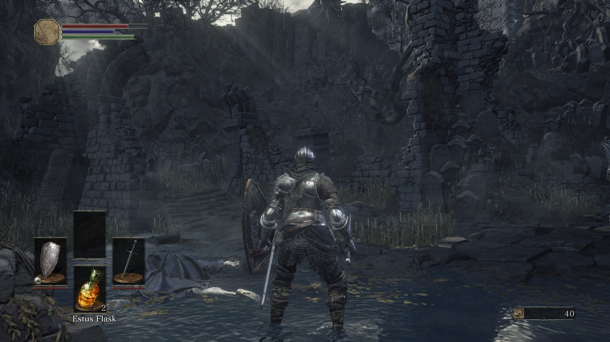
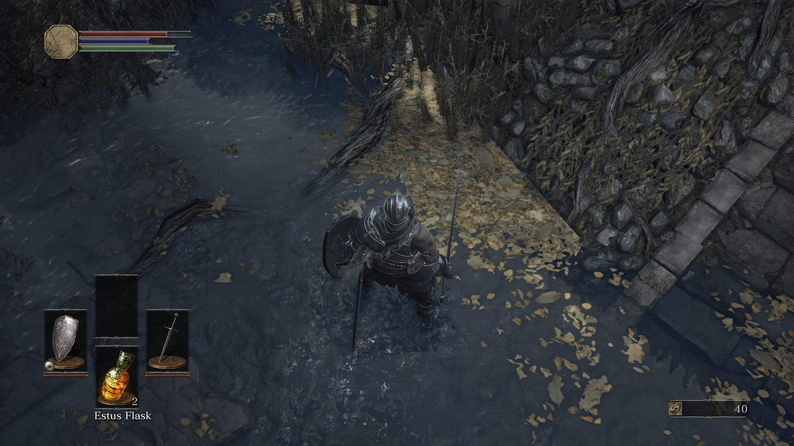
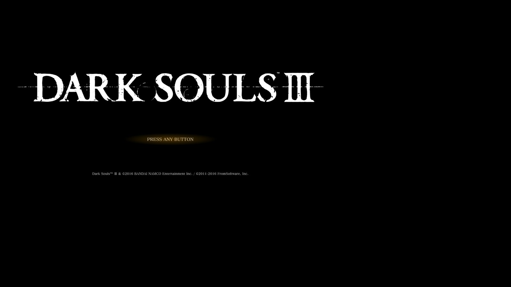

# WINS — WINS Is Not a Sandbox

> **Port Windows (PE) and macOS (Mach-O) programs to native Linux — no Wine, no Darling, no VM.**
> Look inside the binary, find out what it really needs, and re-host it as a normal Linux program.

WINS now explores two native compatibility frontiers:
1. **WINS-Windows (PE)** — unpacks Windows installers, re-hosts Electron/NW.js/.NET apps natively, and runs native Win32/Win64 PE binaries under its own Zig PE loaders (`winrun32` for i386, `winrun64` for x86-64).
2. **WINS-MachO (Darwin / macOS)** — loads `x86_64` Mach-O executables and `.dylib`s directly on Linux in Zig ([`wins-macho/`](./wins-macho/)), translating Darwin ABI, `dyld` fixups, Objective-C runtime (`_objc_msgSend`), and BSD syscalls without a macOS VM or Darling.

WINS takes a Windows installer or executable, works out what it is *made of*, and rebuilds it as something that
runs on Linux by itself. In this project, **a "port" means exactly that: a program made for Windows that now runs on
Linux** (as a launcher + app folder, or as a single AppImage).

Most "Windows-only" desktop software is not really Windows code. It is a web app in Electron, an NW.js game, a
managed .NET program, or a Python bundle, wrapped in a Windows installer. For those, WINS peels the wrapper off and
runs the real program on its native Linux runtime. For genuinely native Win32/Win64 code (C++ against `kernel32`,
`user32`, Direct3D...) WINS does not pretend: it measures how far away a Linux version is, and either builds
fuzz-verified Linux replacements for the Windows APIs the program calls, one function at a time, or runs the program
itself under its own PE loaders (32-bit `winrun32` and 64-bit `winrun64`) that answer those APIs natively.
**Fallout: New Vegas** (i386, Direct3D 9), **Cuphead** (x86-64, Unity / Direct3D 11), and **Dark Souls III**
(x86-64, FromSoftware engine / Direct3D 11 SM5 + tessellation + compute) are the worked examples of the second route.

---

## What is ported today

Every row below was inspected on the author's machine (Ubuntu 24.04). The last column says what has actually been
demonstrated and what has **not** — a launcher existing is not the same as the app working.

| App | What it really is | Result | Demonstrated | Not demonstrated |
|---|---|---|---|---|
| **Look Outside** | RPG Maker MZ game on NW.js 0.94.0 | **Single-file Linux AppImage** (747 MB, no Wine/Proton), saves in `~/.local/share/wins/look-outside/save/`, original install and saves untouched | Opens in a virtual display, reaches the menu, takes keyboard input, `New Game` shows the first dialog; creating `config.rmmzsave` works. SHA-256 `2f239f51…3679` | A full playthrough, save/load of a real game, Steam features (Greenworks for Linux is not bundled) |
| **Notion Desktop 7.42.3** | Electron (Chromium + Node.js 22 + React 19) | Native Linux Electron app in `~/.local/share/notion-desktop`, launcher + desktop entry | Cold boot in 345 ms, `SqliteServer` started, native window created, workspace DOM rendered (`docs/BENCHMARK_5_PROGRAMS.md`). `better-sqlite3` swapped for the Linux ELF prebuild | The 4 Windows-specific native modules are stubbed, not replaced |
| **Qwen 1.0.3.44** | Electron (NSIS + 7z payload, ASAR) | Installed in `~/.local/share/qwen-desktop` (305 MB) with a launcher | Triage output recorded (see *Quickstart*); installed with a launcher | No desktop-menu entry is registered; no recorded run in this repo |
| **ShareX 22.3.0** | .NET 10 + Avalonia UI | Installed in `~/.local/share/sharex-desktop` (491 MB), launcher + desktop entry | Runtime correctly identified; Avalonia X11 assemblies present | A successful launch: it ships a Windows-targeted host, so this is not proven |
| **Notepad++ 8.9.9** | Native Win32 (C++, Scintilla) | Installed via the transpiler path (28 MB); POSIX shims for part of its API surface | Classified, API surface harvested | **The desktop entry is broken** (it points at a deleted temp directory) and a working run is not demonstrated |
| **Fallout: New Vegas** (Steam build) | Native Win32 (i386 C++; Direct3D 9, DirectSound, DirectInput, DirectShow, Bink) | Runs under the WINS i386 PE loader through a Steam compatibility tool (`launch/falloutnv/`): no Proton, no Wine. The installed game is read-only to it; WINS keeps its own profile and saves | Menu, New Game, character creation, Continue from a save, the Mojave exterior, Pip-Boy UI/controls, console teleporting, underwater/water rendering (`SetClipPlane` implemented), effects, Pip-Boy sounds, voices, music and the intro video, rendered on the host GPU (the NVIDIA one on a hybrid laptop). Observed in hand play-throughs on one machine (`2026-11-15`) | Long sessions, most quests, combat-heavy scenes, surface reflection checks across all water cells, controllers (`wins-xinput` unexercised live), live Bink audio run, mods and script extenders. One machine only: Ubuntu 24.04, hybrid AMD/NVIDIA laptop |
| **Cuphead** (Steam build) | Native Win64 Unity 2017.4 game (Mono scripting; Direct3D 11, DirectSound via FMOD, XInput via Rewired, Steamworks.NET) | Runs under the WINS x86-64 PE loader (`winrun64`) through a Steam compatibility tool (`launch/cuphead/`): no Proton, no Wine. Direct3D 11 is translated to OpenGL; the game files are mounted read-only and pinned by SHA-256; WINS keeps its own profile and saves | Title screen, main menu, slot select, saves written, the intro cutscene and storybook, Elder Kettle's tutorial dialogue with its text, a level played to the death card, game audio through PipeWire, keyboard input, and `SteamAPI_Init` against the live Steam client (`[WINS:SteamBridge64] connected to the real host SteamClient017`). Observed in a hand play-through on one machine (`2026-11-18`): cutscenes without stutter, dialogue text visible | Achievement/stat round trips, Steam Cloud, the Steam overlay, controllers live, long sessions, most bosses, the DLC. One machine only: Ubuntu 24.04, NVIDIA, GNOME on X11 |
| **Dark Souls III** (Steam build) | Native Win64 C++ (FromSoftware engine; Direct3D 11 SM5 with VS/HS/DS/GS/PS/CS, deferred contexts, FMOD Ex, DirectInput8/XInput, SteamStub + Arxan) | Runs under `winrun64` through a Steam compatibility tool (`launch/ds3/`): no Proton, no Wine. Full DXBC SM5→GLSL 4.20 translator (tessellation + compute + multi-RT masking), game files mounted read-only and pinned by SHA-256, isolated profile and saves | Steam Play button launch with live `SteamClient017` IPC, SteamStub unpack, title screen, menus, character creation (3D knight), loading screens, and 1920×1080 fullscreen gameplay in Cemetery of Ash with volumetric sky/clouds, god rays, PBR lighting, bloom, water reflections and dynamic ripples, FMOD Ex audio via PipeWire, keyboard/mouse/gamepad input, and zero `glError`/shader failures in the live log (`2026-11-23`) | Full playthrough, bosses, late-game zones, DLCs, Steam Cloud/overlay/achievements, online multiplayer (offline mode only), non-NVIDIA GPUs, stream-output GS, long-session GL view cleanup. One machine only: Ubuntu 24.04, RTX 4050, X11 |
| WinMerge, Greenshot | Native Win32 / legacy .NET Framework + WinForms | Classified only | Correct triage | Nothing runs: they are routed to the transpiler recipe, which only analyses and harvests (the port is **NOT_DEMONSTRATED**) |

**Honest scope:** WINS reliably ports *runtime-wrapped* software (Electron, NW.js, modern .NET). It does **not** yet
run arbitrary native Win32/Win64 applications: its own loaders run one large native 32-bit game (Fallout: New Vegas)
and two native 64-bit games (Cuphead and Dark Souls III), after the Windows APIs and D3D11/DXBC features each game
needs were implemented one by one, and every other native program is a project of its own. `libs/GAPS.md`
measures how far each one is. See *How far can it go?* below for a worked example with a real, huge one.

---

## Dark Souls III running natively on Linux (`winrun64`)

Captured directly from the native X11 window (`1920×1080`, Ubuntu 24.04, NVIDIA RTX 4050) running `DarkSoulsIII.exe`
through `launch/ds3/` under WINS's own Zig x86-64 PE loader (`winrun64`) and DXBC SM5 → OpenGL 4.5 translator — **no
Wine, no Proton, no DXVK**.

| Cemetery of Ash — Volumetric Sky & Horizon | Cemetery of Ash — God Rays & Ruins Lighting |
| :---: | :---: |
|  |  |
| **Water Reflections & Dynamic Expansion Ripples** | **Title Screen (`SteamClient017` IPC + Scaleform UI)** |
|  |  |

Key subsystems built in Zig inside `winrun64` to reach in-game rendering:
- **Win64 PE32+ loader & runtime**: `KUSER_SHARED_DATA`, real `PEB`/`Ldr`/`ProcessHeap`, x64 SEH/`.pdata` unwinding, `int 0x2d`/`int3` exception dispatch (compatible with SteamStub and Arxan runtime checks), and `SteamBridge64` speaking directly to the host's `steamclient.so` (`SteamClient017`).
- **Direct3D 11 + DXBC SM5 → GLSL 4.20 Core translator** (`native/wins_d3d11*.zig`): Vertex, Hull, Domain (quad/triangle/isoline tessellation), Geometry, Pixel, and Compute shaders, deferred contexts & command lists, structured/raw SRV/UAV SSBOs, typed UAV images & atomics, `DrawIndirect`/`DispatchIndirect`, dual-source blending, and exact D3D11 per-RT `OSGN` output masking (`ps_out_mask`) so unwritten render targets (such as DS3's bloom buffer during sky/cloud passes) stay untouched.
- **Audio & input**: FMOD Ex over DirectSound → PipeWire/PulseAudio, DirectInput8 + Win32 mouse/keyboard, and XInput/SDL2 gamepad support.

---

## What it can do

1. **Triage** (`wins probe`) — SHA-256, installer envelope (NSIS, Inno Setup, MSI, 7z), and the real runtime
   (Electron, .NET, PyInstaller, native PE), plus a porting-feasibility verdict. Nothing is executed.
2. **Port** (`wins transmute`) — unpack, patch platform checks, replace Windows native addons with Linux
   prebuilds or safe stubs, re-bind to the Linux runtime, and install a launcher + `.desktop` entry.
3. **Look inside native binaries** (`wins harvest`, `wins-native`) — static PE analysis written in Zig: imports,
   **delay-load imports**, .NET (CLR) header, MSI tables, CAB indexes, dependency closure of a whole product.
4. **Rebuild Windows APIs for Linux, proven by fuzzing** (`winlux*`) — each replacement is differential- or
   metamorphic-fuzzed in a `bubblewrap` sandbox against an independent oracle, and ships with deliberately broken
   variants that the fuzzer **must** catch.
5. **Run native 32-bit and 64-bit Windows programs on its own loaders** (`winrun32`, `winrun64`) — Zig PE loaders plus
   the Windows APIs they answer (`wins-d3d9`, `wins-d3d11`, `wins-dsound`, `wins-dinput`, `wins-xinput`, Steam IPC
   bridge). `winrun32 --imports prog.exe` says which imports resolve and which Windows DLLs have no library yet. See
   [`libs/README.md`](./libs/README.md).
6. **Run `x86_64` macOS Mach-O binaries directly on Linux** (`wins-macho`) — Zig Mach-O loader, minimal `dyld`,
   Objective-C 2.0 runtime, and Darwin ABI / `seccomp-bpf` syscall translation. See [`wins-macho/`](./wins-macho/).
7. **Tell you when it will not work** — with numbers (see 3ds Max below).

---

## The native toolbox (Zig)

Build once (Zig 0.16, `bubblewrap`, and a 7-Zip binary are required):

```bash
mkdir -p build && zig build-exe native/main.zig -O ReleaseSafe -femit-bin=build/wins-native
```

| Command | What it does |
|---|---|
| `wins-native inspect FILE` | SHA-256, PE format, sections |
| `wins-native imports FILE [--json]` | Imports **and delay-load imports**, ordinals, CLR flag |
| `wins-native extract FILE NEW_DIR EXTRACTOR <7z\|inno\|msi>` | Unpack an installer inside a sandbox, into a new directory |
| `wins-native cab-find CAB MEMBER` | Locate a member in a (possibly partial) cabinet without extracting |
| `wins-native closure CAB FILE_TSV ROOT_KEY EXTRACTOR NEW_DIR` | Full dependency closure of a product: 198 PEs in seconds |
| `wins-native compile-c` / `compare` | Compile a candidate shim in a sandbox and compare it to an oracle |

Everything extracted is treated as untrusted data and never executed. Outputs always go to a **new** directory.
The Spanish step-by-step guide with real command output is [`GUIA.md`](./GUIA.md) and
[`native/shims/GUIA.md`](./native/shims/GUIA.md).

---

## Windows APIs rebuilt for Linux (`winlux*`)

| Replacement | Replaces | Oracle | Fuzz result | Must-catch bugs |
|---|---|---|---|---|
| last-error | `GetLastError` / `SetLastError` | thread-isolation observation | 100 000 iterations match | process-global state |
| text | `MultiByteToWideChar` / `WideCharToMultiByte` (CP_UTF8) | independent C table decoder, cross-checked against CPython's UTF-8 codec on 20 000 vectors | 200 000 iterations match; every outcome (ok, 87, 122, 1004, 1113) exercised | per-byte replacement, destination overrun |
| **winluxtrust** | the digest half of `WinVerifyTrust` (Authenticode) | `osslsigncode` | 200 000 mutations in 38 s, all classes match | hashing the checksum field, accepting any digest |
| **winluxhttp** | proxy selection used by Qt's `WinHttp*` calls | metamorphic relations (no real WinHTTP available) | 20 000 scenarios in 1.8 s | ignoring scheme scope, case-sensitive bypass |

What each one does **not** do is part of its contract:

- **winluxtrust never reports "trusted".** It computes the Authenticode PE hash and compares it with the digest in
  the PKCS#7 signature. A match returns `0x20570001` (*digest matches, chain unverified*), deliberately **not**
  `ERROR_SUCCESS`. Certificate chains, signature values, revocation and timestamps are not implemented.
- **winluxhttp only chooses proxies.** There is no HTTP transport, PAC script engine or WPAD detection — and none is
  needed by the Qt libraries it was built for, which only ask Windows where the proxy is. Behaviour in corners the
  documentation does not pin down is an assumption, not a verified match with Windows.
- None of these is itself a PE loader. The loaders are separate programs, described next.

---

## Running native Windows programs: the WINS loaders

| Loader | Runs | State |
|---|---|---|
| `winrun32` | 32-bit (i386) PE32 | Runs Fallout: New Vegas (see the table above). `--check` and `--imports` resolve a program's imports without running it; `--libs` prints the library registry |
| `winrun64` | x86-64 PE32+ with a window, Direct3D 11 SM5 (on OpenGL 4.5), DirectSound, DirectInput8, XInput, Steam | Runs **Cuphead** and **Dark Souls III** (see the table and screenshots above). Full SM5 shader translation (VS/HS/DS/GS/PS/CS + tessellation + compute + deferred contexts), Win32 sync objects (events, semaphores, waitable timers, IOCP, APCs), x64 SEH unwinding, and a Win64↔Linux Steamworks bridge (`SteamClient017`) to the host's `steamclient.so` |
| `winrun` | x86-64 console PE32+ | Maps the image, resolves imports and **refuses to run if any is missing**; execution requires the boxed launcher. No program is claimed to run on it here |
| `winrun_gui` | x86-64 with a window | Same, with the window support. `--check` measures; no program is claimed to run on it here |

Each Windows DLL a loader answers for is a **library** with a version (`wins-d3d9 0.1.0`, ...), recorded in
[`native/wins_libs.zig`](./native/wins_libs.zig); [`libs/README.md`](./libs/README.md) explains how to read it, and
[`libs/GAPS.md`](./libs/GAPS.md) (generated) lists the DLLs and imports WINS still lacks compared with what real
programs ask for. A resolved import is not a working API: the registry's `status` and `evidence` say what was actually
run.

### How to use each native Steam launcher

#### 1. Fallout: New Vegas (`winrun32`, i386 / Direct3D 9)
Requirements (32-bit libraries, `bubblewrap`) are in [`launch/falloutnv/README.txt`](./launch/falloutnv/README.txt):

```bash
tools/build_all.sh /tmp/wins-build                  # a new, empty directory
launch/falloutnv/install.sh /tmp/wins-build         # restart Steam -> Properties > Compatibility > "WINS (Fallout: New Vegas)"
```

Your Steam saves are untouched; WINS keeps its own profile in `~/.local/share/wins/falloutnv/profile` and logs in
`~/.local/state/wins/falloutnv/logs/`.

#### 2. Cuphead (`winrun64`, x86-64 / Unity / Direct3D 11)
`tools/build_all.sh` does not build `winrun64` yet, so build `winrun64` once and install the compatibility tool.
Details (pinned game hashes, sandbox policy) are in [`launch/cuphead/README.txt`](./launch/cuphead/README.txt):

```bash
mkdir -p /tmp/wins-win64-build
(cd native && zig build-exe winrun64.zig -O ReleaseSafe -lc -lX11 -femit-bin=/tmp/wins-win64-build/winrun64)
launch/cuphead/install.sh /tmp/wins-win64-build     # restart Steam -> Properties > Compatibility > "WINS (Cuphead)"
```

The installed game is mounted read-only and verified against pinned SHA-256s. Saves live in
`~/.local/share/wins/cuphead/profile`; logs (including `unity.log`) go to `~/.local/state/wins/cuphead/logs/`.

#### 3. Dark Souls III (`winrun64`, x86-64 / Direct3D 11 SM5)
Uses the same `winrun64` binary built above. Full details, pinned hashes, and offline guidance are in
[`launch/ds3/README.txt`](./launch/ds3/README.txt):

```bash
mkdir -p /tmp/wins-win64-build
(cd native && zig build-exe winrun64.zig -O ReleaseSafe -lc -lX11 -femit-bin=/tmp/wins-win64-build/winrun64)
launch/ds3/install.sh /tmp/wins-win64-build         # restart Steam -> Properties > Compatibility > "WINS (Dark Souls III)"
```

Restart Steam once, open **DARK SOULS III → Properties → Compatibility**, select **`WINS (Dark Souls III)`**, and
click **Play** (recommended: **Offline mode**). The game folder is mounted read-only; saves and `GraphicsConfig.xml`
live in `~/.local/share/wins/ds3/profile`, and logs go to `~/.local/state/wins/ds3/logs/`.

**`winrun64` diagnostics (all off by default, pass via Steam Launch Options):**
- `WINS_D3D11_DUMP_DIR=<dir>` — dump translated GLSL & DXBC shaders
- `WINS_D3D11_CAPTURE=<dir>` — capture failed shader DXBCs for offline debugging
- `WINS_D3D11_TRACE_DRAWS=1` — log per-frame draw calls (`WINS_D3D11_TRACE_PROG=<n>` to filter one program)
- `WINS_D3D11_SNAP_TRIG=1` — enable on-demand 1-frame RenderDoc-style capture (`touch <profile>/snap_req` → `snap_out/{draws.log,final.ppm,p*_*.{glsl,dxbc}}`)
- `WINS_GPU=integrated` — keep integrated GLX GPU instead of NVIDIA PRIME; `WINS_TRACE=1` — verbose loader trace

---

## How far can it go? A real example: Autodesk 3ds Max 2026

WINS was pointed at the full installer (5.76 GB). It deposits every file without Windows, then measures:

- 198 PE files in the dependency closure, **3 129** external API functions needed, **4** with a Linux replacement.
- The MSI runs Windows custom-action code, so extracting is not installing.
- `3dsmax_interop.dll` is a mixed-mode C++/CLI assembly, which Microsoft documents as Windows-only.
- Direct3D 9/11 and MSVC redistributables are further blockers; Autodesk licensing is untested.

**Verdict: not portable with WINS today; absolute impossibility is not claimed.** The evidence and claims table is in
[`docs/3DSMAX_FEASIBILITY_2026-11-07.md`](./docs/3DSMAX_FEASIBILITY_2026-11-07.md). The same machinery that says
"no" here is what makes the "yes" on Notion and Look Outside trustworthy.

---

## Subdirectories & System Boundaries

- **bin**: [./bin/README.md](./bin/README.md) - Unified CLI command dispatcher (`probe`, `transmute`, `harvest`, `fuzz`, `test`, `list`, `heal-bin`, `port-context`, `fallout`, `corpus-attack`) providing human and agent-facing JSON interfaces.
- **core**: [./core/README.md](./core/README.md) - Central processing engine providing binary taxonomy inspection and black-box runtime diagnostic telemetry.
  - **healers**: [./core/healers/README.md](./core/healers/README.md) - Native C++ `.node` binary addon auditor, GNU glibc prebuild resolver, and universal JavaScript proxy stubber.
  - **recipes**: [./core/recipes/README.md](./core/recipes/README.md) - Modular extraction and re-hosting transmuters for Electron, .NET Core / Avalonia, PyInstaller, and Native PE.
  - **transpiler**: [./core/transpiler/README.md](./core/transpiler/README.md) - Static PE parser, IAT/RTTI lineage extractor, and zero-Win32 POSIX C/Zig shimming layer.
  - **fuzzer**: [./core/fuzzer/README.md](./core/fuzzer/README.md) - Ultra-high-throughput Zig differential fuzzing engine (>7,000,000 ops/sec) for proving API equivalence.
- **libs**: [./libs/README.md](./libs/README.md) - The Windows DLLs WINS stands in for, as versioned libraries (`wins-d3d9`, `wins-dsound`, ...), what has been run through each, and the generated gap report of the DLLs and imports WINS still lacks compared with Windows.
- **launch**: [./launch/falloutnv/README.txt](./launch/falloutnv/README.txt) - The Steam compatibility tool for Fallout: New Vegas (launcher, installer): the Play button runs the game under the WINS i386 loader.
  - [./launch/cuphead/README.txt](./launch/cuphead/README.txt) - The Steam compatibility tool for Cuphead: the Play button runs the Win64 game under `winrun64`.
  - [./launch/ds3/README.txt](./launch/ds3/README.txt) - The Steam compatibility tool for Dark Souls III: the Play button runs `DarkSoulsIII.exe` under `winrun64`.
- **wins-macho**: [./wins-macho/](./wins-macho/) - Experimental Zig `x86_64` Mach-O loader, minimal `dyld`, Objective-C 2.0 runtime, and Darwin ABI / `seccomp-bpf` translation layer.

---

## Global Invariants

1. **Cleanroom Non-Pollution**: Every extraction and transmutation must operate inside an ephemeral, unprivileged scratchpad (`/tmp/wins-cleanroom-*`). No persistent virtual Windows registry, `~/.wine` prefixes, or global OS state pollution may be retained.
2. **Dynamic Linker Safety**: Windows PE binaries (`MZ` header) must never be passed to Linux host dynamic loaders (`dlopen`, ld.so). Native addons must be substituted with Linux ELF prebuilds or neutralized via safe JavaScript proxy stubs before execution.
3. **Fail-Closed Verification**: The CLI must exit with code `0` on successful operations and code `1` upon errors. Machine-readable modes (`--json`) must emit strictly valid JSON to stdout without banner interference.
4. **Desktop Environment Protocol**: Transmuted applications must integrate natively with standard XDG specifications: launchers in `~/.local/bin/` with mode `0755` and desktop shortcuts in `~/.local/share/applications/`.

---

## Global Side Effects

- **Filesystem Writes**:
  - Application installations: `~/.local/share/<app>-desktop/`.
  - Executable launchers: `~/.local/bin/<app_id>`.
  - Desktop entries: `~/.local/share/applications/<app_id>.desktop`.
  - Local caches: `~/.cache/wins/prebuilds/` and `~/.cache/wins/runtimes/electron/`.
- **Network Access**:
  - Downloads official Linux Electron runtime binaries from GitHub releases when not cached.
  - Queries npm registry via `npm pack` to obtain official Linux ELF `.node` prebuilds.
- **Process Spawning**:
  - Unpackers: `7zz`, `innoextract`, `tar`, `unzip`.
  - Ephemeral Wine execution strictly bounded to silent extraction with explicit process group cleanup (`killall -9`).
  - Diagnostic test subprocesses launched under isolated session IDs (`os.setsid`).

---

---

## System Verification

```bash
# Python subsystems (triage, recipes, healers, transpiler, fuzzer front-end)
python3 -m unittest discover tests

# Native Zig tools and winlux replacements (need zig 0.16, bubblewrap, openssl)
python3 -m unittest native.test_pe_imports native.test_win32_text native.test_winluxhttp native.test_winluxtrust
```

```bash
# The loaders and the library registry (zig 0.16, bubblewrap; i386 libraries for the loader)
tools/build_all.sh /tmp/wins-build              # a new, empty directory
tools/check_libs.sh /tmp/wins-build             # is libs/registry.json current?
tools/separation_gate.sh                        # the shipped loader does not depend on native/probe
zig test native/wins_libs.zig
python3 -m pytest tests/test_winrun32.py
# Win64 D3D11 & DXBC shader translator unit tests (zig 0.16, libX11)
zig test native/wins_d3d11_shader.zig -lc
zig test native/wins_d3d11_gl.zig -lc
zig test native/wins_d3d11.zig -lc -lX11
```

`native.test_winluxtrust` also needs `osslsigncode` (set `WINS_OSSLSIGNCODE` if it is not on `PATH`) and skips itself
when it is missing.

---

## Quickstart — Usage by Component

### Prerequisites
* Linux x86_64 (tested on Ubuntu 24.04 LTS), `python3`, `7zz` (or `7z`), `unzip`, `curl`.
* Electron apps: `bunx` or `npx` (ASAR unpacking). Native tools & Mach-O loader: Zig 0.16 and `bubblewrap`.
* Native 32-bit games (Fallout: New Vegas): the i386 libraries named in `launch/falloutnv/README.txt`.
* Native 64-bit games (Cuphead, Dark Souls III): `libX11`, OpenGL 4.5 (GLX), PulseAudio/PipeWire, and SDL2; see `launch/cuphead/README.txt` and `launch/ds3/README.txt`.

### Install CLI
```bash
git clone https://github.com/DannyBaanks/WINS.git
cd WINS
export PATH="$PWD/bin:$PATH"
```

### Usage examples for each subsystem

```bash
# 1. Runtime-wrapped desktop apps (Electron / .NET / NW.js)
wins probe     Qwen-1.0.3.44-release-win-x64.exe        # inspect runtime & feasibility (--json for agents)
wins transmute Qwen-1.0.3.44-release-win-x64.exe        # re-host natively on Linux + launcher/.desktop
wins heal-bin  ~/.local/share/manus-desktop --app-id manus   # heal Windows companion .exe helpers
wins test      notion --timeout 5.0                     # cleanroom run + structured diagnostics
wins list                                               # list available recipes

# 2. Static PE inspection & native Zig toolbox (wins-native)
mkdir -p build && zig build-exe native/main.zig -O ReleaseSafe -femit-bin=build/wins-native
build/wins-native inspect   SomeApp.exe                 # SHA-256, PE format, sections
build/wins-native imports   SomeApp.exe --json          # IAT + delay-load imports + CLR flag
wins harvest   npp.8.9.9.Installer.x64.exe              # harvest APIs & embedded engines

# 3. Differential API fuzzing (winlux*)
wins fuzz --iterations 100000                           # fuzz Win32 shims against independent oracles

# 4. Native 32-bit Windows games (winrun32 — Fallout: New Vegas)
tools/build_all.sh /tmp/wins-build
/tmp/wins-build/winrun32 --imports FalloutNV.exe        # check import resolution without executing
launch/falloutnv/install.sh /tmp/wins-build             # install Steam compatibility tool

# 5. Native 64-bit Windows games (winrun64 — Cuphead & Dark Souls III)
mkdir -p /tmp/wins-win64-build
(cd native && zig build-exe winrun64.zig -O ReleaseSafe -lc -lX11 -femit-bin=/tmp/wins-win64-build/winrun64)
launch/cuphead/install.sh /tmp/wins-win64-build         # install "WINS (Cuphead)" in Steam
launch/ds3/install.sh     /tmp/wins-win64-build         # install "WINS (Dark Souls III)" in Steam

# 6. macOS Mach-O x86_64 binaries on Linux (wins-macho)
(cd wins-macho && zig build && zig build test)
wins-macho/zig-out/bin/wins_macho --inspect-only /path/to/macos_bin
wins-macho/zig-out/bin/wins_macho /path/to/macos_bin [args...]
```

Example `probe` output:

```text
[TARGET] Qwen-1.0.3.44-release-win-x64.exe (119.2 MB)
  SHA-256:  393e4669402e48f3fa6cffd0ebaadfe597b06fb26a11b6aaf03f7ee74df26e60

[ENVELOPE] Nullsoft Scriptable Install System (NSIS)

[DETECTED RUNTIME] ELECTRON
  framework: Electron (Chromium + Node.js Web Architecture)
  envelope_compression: NSIS + Embedded 7z payload
  contains_asar: True

[PORTING FEASIBILITY] EXCELLENT (100% native Linux re-hosting; 0 Wine emulation required)
[RECOMMENDED RECIPE]  recipe_electron
```

---

## Runtime support (what the code does today)

| Runtime | State |
|---|---|
| **Electron** | Working: ASAR de-layering, platform-check patching, `.node` healing with Linux prebuilds, runtime re-binding. Demonstrated on Notion |
| **NW.js (RPG Maker MZ games)** | No `wins` recipe yet: Look Outside was packaged as an AppImage separately (its own `GUIA.md` lives next to the AppImage in `~/Documentos/Look Outside Linux/` on the author's machine). Turning that into a recipe is the obvious next step |
| **.NET (modern) / Avalonia** | Extraction and `runtimeconfig.json` adaptation implemented; a successful launch of ShareX is not demonstrated |
| **Native Win32 / Win64 PE** | i386: the WINS PE loader (`winrun32`) runs Fallout: New Vegas. x86-64: `winrun64` runs Cuphead and Dark Souls III (with SM5 DXBC→GLSL tessellation + compute); `winrun` / `winrun_gui` resolve imports and refuse anything incomplete, with no program claimed to run on them. Everything else: triage and API harvest (`recipe_transpiler`, analysis only; the port is NOT_DEMONSTRATED) |
| **PyInstaller** | Recipe is a stub (`transmute` returns failure) |
| **JVM / Launch4j** | Planned |

### 4. Heal Companion Binaries of an Installed App

Runtime-wrapped apps usually ship **Windows-only helper executables** next to
their payload (`resources/bin/*.exe`: device agents, sidecars, utility hosts).
On Linux the application spawns them **without the `.exe` extension**, so a
naive transmutation leaves the app with a broken connector.

```bash
wins heal-bin ~/.local/share/manus-desktop --app-id manus
```

`heal-bin` is native-first:
1. **Native re-binding** — a Linux ELF build of the helper is fetched (vendor
   Linux package or `~/.cache/wins/companions/`) and installed under the
   extension-less host name.
2. **Micro-Wine shim** — when no native build exists, WINS generates a
   hardened launcher that re-hosts the PE under an isolated Wine prefix
   (local-API fd relay, deterministic pipe handshake, no `~/.wine` pollution).

Unlike a hand-written wrapper, the shim is tracked by the toolchain, can be
re-applied at any time and is covered by the test suite.

```bash
wins heal-bin <app-dir> --dry-run --json   # report only, machine readable
```

---

## WINS-MachO — macOS Mach-O Frontier (`wins-macho/`)

An experimental, evidence-driven Mach-O 64-bit (`x86_64`) loader and Darwin ABI runtime written in **Zig 0.16.0** — no macOS VM, no Darling, no Apple SDKs or proprietary binaries in the repository.

### Build & test

```bash
cd wins-macho
zig build && zig build test
./zig-out/bin/wins_macho [--inspect-only] [--run-id <id>] <macho_path> [args...]
```

### Architecture

- **Mach-O Parser & Universal Slice Extractor** (`src/macho/`): fail-closed 64-bit Mach-O parser + `FAT_MAGIC` Universal Binary `x86_64` slice extraction, `LC_DYLD_INFO_ONLY` rebase/bind/lazy_bind opcodes, `LC_DYLD_EXPORTS_TRIE`, and `LC_DYLD_CHAINED_FIXUPS` (`DYLD_CHAINED_PTR_64` / `DYLD_CHAINED_PTR_64_OFFSET`).
- **Memory Mapper & Entrypoint** (`src/loader/`): skips `__PAGEZERO`, reserves `PROT_NONE`, copies segments + zero-fill, restores strict `initprot` (`r-x` / `rw-` / `r--`, no global RWX), and transfers control to `LC_MAIN` using System V AMD64 ABI.
- **Minimal `dyld`** (`src/dyld/`): dependency graph, `@executable_path` / `@loader_path` / `@rpath` expansion, flat/weak namespace lookup, and explicit `UNRESOLVED_SYMBOL` reporting.
- **Darwin ABI & Kernel Trap Boundary** (`src/darwin/`, `src/runtime/`):
  - `DarwinStat64` (144-byte `stat`/`lstat`/`fstat`) & `DarwinDirent64` (`opendir$INODE64`/`readdir$INODE64`) layout translation.
  - `DarwinRuneLocale` (`__DefaultRuneLocale`, `___maskrune`, `___tolower`), `mach_absolute_time`, `mach_timebase_info`, `sysctlbyname`, `pthread_mutex_*`, `arc4random*`, `_NSGetExecutablePath`, `dlopen`/`dlsym`.
  - Minimal Objective-C 2.0 runtime (`objc.zig`): parses `ObjcClass`/`ClassRoT`/`MethodListT` and dispatches `_objc_msgSend` via a naked `x86_64` tail-call dispatcher.
  - `seccomp-bpf` (`SECCOMP_RET_TRAP` for `rax >= 0x1000000`) + `SIGSYS` handler translating Darwin BSD `SYS_write` (`0x2000004`) and logging `FIRST_UNSUPPORTED_KERNEL_BOUNDARY` on Mach traps (e.g. `0x100001a` `mach_reply_port`) into `evidence/<run-id>/crash.json`.

### What is demonstrated vs not demonstrated

| Target / Capability | Status | Observed Result |
|---|---|---|
| Adversarial parser & Universal `FAT_MAGIC` / Chained Fixups tests | **DEMONSTRATED** | `zig build test` passes (exit 0) |
| Custom `x86_64` Mach-O (`target_a_nostdlib`, `target_b_main` + `@rpath/libhelper.dylib`, `target_c_cli`, `target_e_darwin_apis`) | **DEMONSTRATED** | Executes natively on Linux; `pthread_create`, `stat`, `sysctlbyname`, `mach_absolute_time`, `dlopen`/`dlsym` verified |
| Objective-C 2.0 ARC Mach-O (`target_f_objc.m`) | **DEMONSTRATED** | `[Greeter add:10 to:5]`, `[Greeter alloc]`, `initWithFactor:3`, `[g scale:15]` -> `objc class=15 instance_scaled=45` (exit 45) |
| Darwin BSD syscall vs Mach trap boundary (`target_c_syscall_probe`) | **DEMONSTRATED / BLOCKED** | `0x2000004` (`SYS_write`) executes; `0x100001a` (`mach_reply_port`) traps cleanly as `SIGSYS` (`crash.json`) |
| Third-party macOS Sonoma CLI (`tree 2.3.2` from Homebrew, `LC_DYLD_CHAINED_FIXUPS`) | **PARTIAL (DEMONSTRATED / BLOCKED)** | `tree -L 2 /tmp/brew-probe` lists real Linux directories and exits `0`; `tree --version` hits `SIGSEGV` (`rdi=0x0` after `_strlen`) |
| `Foundation` / `AppKit` / `libswiftCore` / `arm64` execution | **NOT_DEMONSTRATED** | `arm64` binaries are inspectable via `--inspect-only` and rejected for execution (`IncompatibleArchitecture`) |

---

## Agentic interoperability

WINS is built to be driven by coding agents: `wins probe --json` returns the structured taxonomy, `wins transmute`
performs the port, and `wins test --json` returns stderr telemetry with structured `agent_actions`. Instead of
fighting a Wine prefix, an agent can decide, port, or report why not — with evidence.

---

## Limits (NOT_DEMONSTRATED)

A PE import inventory, a compiled shim, or a finite fuzz run is not proof that a Windows program was ported or behaves
equivalently. No `winlux*` replacement has been compared with a real Windows kernel. Games and apps are verified only
as far as the table above says. Fallout: New Vegas, Cuphead, and Dark Souls III were checked by hand on one machine,
not by an automated end-to-end test (the loaders' unit and regression tests cover pieces such as DXBC shader
translation, D3D11 state/blend/RT semantics, staging texture uploads, and sync objects); the gap report measures
import resolution, not behaviour.

---

## License
WINS is open-source software licensed under the [MIT License](LICENSE).
